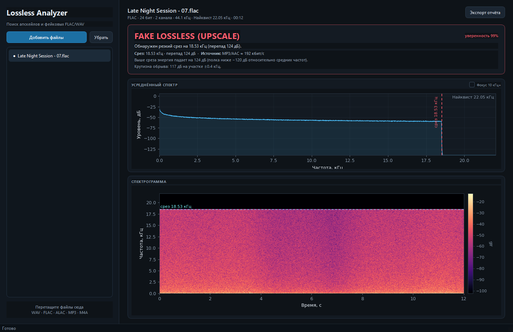

# Lossless Analyzer

Десктопное приложение для проверки того, является ли аудиофайл настоящим
lossless. Ищет «кирпичную стену» в спектре — след lossy-кодека (MP3/AAC),
пересохранённого во FLAC/WAV, и определяет апскейлы hi-res из CD-источника.



## Возможности

- Загрузка WAV, FLAC, AIFF, OGG, MP3, M4A/ALAC, AAC и других форматов
  (список файлов, диалог или drag-and-drop).
- Усреднённый по файлу спектр в дБFS с отметками частоты Найквиста и среза.
- Спектрограмма с цветовой картой `magma` и разметкой найденного среза.
- Автоматический вердикт с цветовой индикацией и уверенностью:
  - `TRUE LOSSLESS` — резких срезов нет, энергия доходит до Найквиста;
  - `FAKE LOSSLESS (UPSCALE)` — найден обрыв спектра (включая «мягкие»
    апскейлы после ресемплера);
  - `INCONCLUSIVE` — тихий/тёмный материал, данных недостаточно;
  - `LOSSY SOURCE` — исходный контейнер сам по себе сжат с потерями.
- Оценка вероятного исходного формата по частоте среза
  (например, «MP3/AAC ≈ 192 кбит/с» или «апскейл с 44.1 кГц»).
- Экспорт отчёта в PNG/PDF: вердикт, метаданные, оба графика.
- Фоновый анализ: интерфейс не замерзает даже на длинных файлах.

## Установка

Нужен Python 3.10+.

```powershell
cd G:\music\analyzer
python -m venv .venv
.venv\Scripts\Activate.ps1
python -m pip install --upgrade pip
pip install -r requirements.txt
```

На Linux/macOS активация окружения: `source .venv/bin/activate`.

Важно: с NumPy 2 нужен matplotlib 3.9 или новее. Если в системе уже стоит
старый matplotlib 3.7, обновите его (`pip install -U "matplotlib>=3.9"`),
иначе при запуске будет ошибка про `numpy.core.multiarray`.

### ffmpeg (опционально)

WAV/FLAC/MP3/OGG читаются напрямую через `soundfile`. Для M4A/ALAC/AAC/WMA
программа автоматически декодирует файл через `ffmpeg` во временный WAV.
Если ffmpeg не установлен, эти форматы не откроются — остальные продолжат
работать.

- Windows: `winget install Gyan.FFmpeg` (или скачать с ffmpeg.org);
- macOS: `brew install ffmpeg`;
- Linux: `sudo apt install ffmpeg`.

## Запуск

```powershell
python main.py
```

Добавьте файлы кнопкой «Добавить файлы», через `Ctrl+O` или перетащите их в
окно. Анализ выполняется по очереди; клик по файлу в списке показывает его
результат. `Ctrl+E` — экспорт отчёта, `Delete` — убрать файл из списка.

## Как это работает

1. **Опорный уровень.** Усреднённый спектр (БПФ с окном Ханна, потоковое
   чтение) переводится в дБ относительно полосы 1–4 кГц.
2. **Сглаживание.** Медианный фильтр и скользящее среднее убирают узкие
   тональные пики, оставляя форму огибающей.
3. **Поиск обрыва.** Для частот от 9.5 кГц до (Найквист − guard) считаются:
   - перепад между полосами до и после кандидата (широкий и локальный);
   - крутизна обрыва (доля перепада, приходящаяся на ±400 Гц);
   - разброс уровня на «полке» после среза.
   Кандидат проходит, если перепад ≥ 22 дБ, локальный перепад ≥ 12 дБ,
   обрыв достаточно крутой, а полка плоская. Положение уточняется по
   максимальному градиенту.
4. **Мягкий апскейл.** Если резкой стены нет, но контейнер hi-res, а спектр
   заканчивается около 22/24/32/44/48 кГц (типичные границы исходников),
   включается детектор ограничения полосы. Так ловятся апскейлы, у которых
   SRC-фильтр растянул срез на несколько кГц.
5. **Вердикт.** Без обрыва проверяется энергия у верхней границы диапазона:
   есть энергия — lossless, тихо/тёмно — inconclusive.

Частота среза переводится в оценку битрейта по таблице, откалиброванной по
LAME: 128 кбит/с ≈ 16.6 кГц, 192 ≈ 18.8 кГц, 320 ≈ 20.2 кГц (для 44.1 кГц).
Оценка приблизительная: у AAC и разных версий кодеков срезы отличаются.

## Ограничения

- Настоящий lossless, который специально отфильтрован (лоу-фай, «тёплый»
  мастер без ВЧ), может быть помечен как fake — резкий срез есть резкий срез.
- Очень тёмный или тихий lossless без выраженных ВЧ даёт `INCONCLUSIVE`.
- Программа не проверяет разрядность (16 бит в 24-битном контейнере) и не
  доказывает lossless-происхождение — она ищет характерные артефакты сжатия.
- Длинные файлы читаются целиком (потоково), поэтому анализ может занять
  время; количество кадров для графиков ограничено, чтобы память не росла.
- Для файлов короче ~0.05 с анализ невозможен.

## Тесты

```powershell
python -m unittest discover -s tests -v
```

Тесты используют синтетические файлы: настоящий широкополосный сигнал,
жёсткий срез на 18 кГц, апскейл 44.1 → 96 кГц и реальное MP3, пересохранённое
во FLAC (если в системе есть ffmpeg с libmp3lame).

## Структура проекта

```
main.py                        точка входа
lossless_analyzer/
  loader.py                    чтение файлов, метаданные, fallback на ffmpeg
  dsp.py                       усреднённый спектр и спектрограмма
  detector.py                  поиск кирпичной стены и вердикт
  analysis.py                  оркестрация анализа
  plots.py                     графики и экспорт отчёта
  gui.py                       окно PySide6, очередь, drag-and-drop
  formatting.py                форматирование значений
tests/                         unittest-тесты
requirements.txt
```
